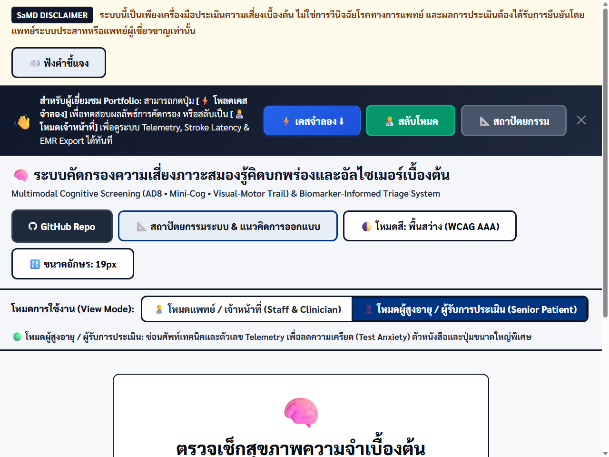
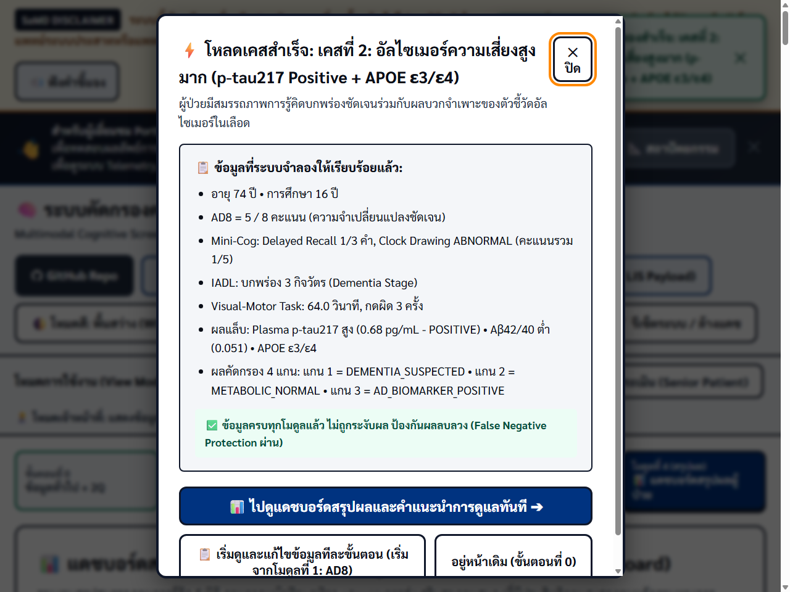

# Thai Cognitive Triage CDSS (`Project-Alzheimer`)

**Prototype Clinical Decision Support System (CDSS) for Elderly Cognitive Screening & Multimodal Triage in Thailand.**  
Combines a zero-friction Senior Patient Wizard (`index.html`), a Single-Source TypeScript Clinical & FHIR R4 Engine (`src/` -> `dist/`), and a Synthetic Analytics & In-Browser ML Triage Dashboard (`dashboard.html`).

[](LICENSE)
[](#hl7-fhir-r4--loinc-terminology-27-parameters)
[](#hl7-fhir-r4--loinc-terminology-27-parameters)
[](#dual-application-architecture)
[](#limitations--regulatory-disclaimer)
[-orange.svg)](#limitations--regulatory-disclaimer)

---

## Live Demo & Interface Preview

| Application | Access Link | Purpose & Runtime Model |
| :--- | :--- | :--- |
| **1. Cognitive Screening & CDSS Portal** | [`index.html`](https://natchlimar-droid.github.io/Project-Alzheimer/) | **Offline-First Core (Zero External Runtime Dependencies):** Dual-Role UI (Senior Wizard + Clinician Workstation), prebuilt `dist/clinical-engine.js`, PWA `sw.js` precaching, and HL7 FHIR R4 Bundle export/import. |
| **2. NeuroRegistry & ML Triage Dashboard** | [`dashboard.html`](https://natchlimar-droid.github.io/Project-Alzheimer/dashboard.html) | **Online Analytics View (Uses CDN Chart.js / Tailwind / Lucide):** 25-case synthetic patient registry, 4 interactive charts, and an educational in-browser Logistic Regression demo. |

| Patient-Friendly Screening Mode | Clinical Staff & Telemetry Workstation |
| :---: | :---: |
|  |  |
| *Large typography (19–24 px), `>= 60 px` touch targets, telemetry hidden* | *4-Axis breakdown, CDT kinematic tremor filter, LIS labs, FHIR R4 export* |

---

## Single-Source-of-Truth Engine & Project Structure

All clinical triage rules, differential lab thresholds, and HL7 FHIR R4 serialization live in a single authoritative TypeScript source (`src/`), compiled with Node's native `stripTypeScriptTypes` (`scripts/build-engine.mjs`) into `dist/` and shared across the browser app, Node.js test suite, and FHIR validator:

```text
src/*.ts  ──(node scripts/build-engine.mjs)──▶  dist/clinical-engine.js (IIFE) ──▶ index.html + sw.js
   │                                           └─ dist/clinical-engine.mjs (ESM) ──▶ scripts/validate-fhir.mjs
   └────────────(native Node TypeScript)────────▶ test-runner.mjs (node --test) & GitHub Actions CI
```

| File / Directory | Role |
| :--- | :--- |
| [`src/types/clinical.ts`](src/types/clinical.ts) | Domain interfaces (`AssessmentInput`, `RiskOutput`, `LabResults`, `LoincCodeDefinition`, `PIIIdentityRecord`). |
| [`src/data/clinicalContent.ts`](src/data/clinicalContent.ts) | Audited 27-parameter `LOINC_DATA_MAPPING`, `SAMD_DISCLAIMER_TH`, `FHIR_LOCAL_CODE_SYSTEM`, 27 ACB drugs, `4AT`, `BriefIADL`, `AD8`, and Mini-Cog Thai word sets. |
| [`src/engine/riskStratification.ts`](src/engine/riskStratification.ts) | 4-Axis risk stratification, thyroid/Ca/eGFR differential rules, education-adjusted Non-Literate pathway, AD8 Unsure (`NA`) guardrails, and lab field alias normalization. |
| [`src/engine/cdtAnalyzer.ts`](src/engine/cdtAnalyzer.ts) | Clock Drawing geometric analysis and high-frequency motor tremor smoothing. |
| [`src/services/fhirService.ts`](src/services/fhirService.ts) | HL7 FHIR R4 `Bundle` generator (`buildFhirR4Bundle`), round-trip parser (`parseFhirBundleToLabResults`), and validator (`validateFhirR4Bundle`). |
| [`src/services/privacyAuditService.ts`](src/services/privacyAuditService.ts) | In-memory PII vault separation, 256-bit salted pseudonymization, and hash-chained audit logs. |
| [`scripts/build-engine.mjs`](scripts/build-engine.mjs) | Zero-dependency bundler building `dist/clinical-engine.mjs` & `dist/clinical-engine.js` (`--check` verifies CI parity). |
| [`scripts/validate-fhir.mjs`](scripts/validate-fhir.mjs) | Automated FHIR R4 structure, `LP*` Part-code exclusion, and round-trip lab parsing check. |
| [`test-runner.mjs`](test-runner.mjs) | `node:test` verification suite (Bundle parity, `TC-01`–`TC-18` core suite, `TC-19`–`TC-29` hardened regressions). |
| [`docs/CASE_STUDY_AND_PORTFOLIO.md`](docs/CASE_STUDY_AND_PORTFOLIO.md) | Detailed UX/Product Case Study, Thailand clinical rationale, safety guardrails, and portfolio summary. |

---

## Explainable AI (XAI) Feature Weights & Clinical Cutoff References

### 1. Normalized Explainable Feature Contribution Weights (`100% Total`)
Used in the synthetic in-browser triage demo (`dashboard.html`) to visualize relative feature weighting:

| Screening Feature Domain | Normalized Weight | Clinical Rationale |
| :--- | :---: | :--- |
| Delayed Word Recall / Verbal Fluency | **30%** | Primary episodic memory / semantic retrieval signal |
| AD8 Informant Functional Change | **22%** | Longitudinal informant-reported daily cognitive decline |
| AD Biomarkers (Plasma p-tau217 / Aβ42-40) | **20%** | Alzheimer's-specific pathophysiology indicator (symptomatic workup only) |
| Clock Drawing / Visuospatial-Executive | **18%** | Executive planning and visuospatial construction |
| Affective (2Q) & Medication Burden (ACB) | **10%** | Reversible pseudodementia and drug-induced confounder weight |
| **Total Normalized Feature Budget** | **100%** | Explicitly normalized across all 5 triage dimensions |

> **ML Triage Framing:** The in-browser Logistic Regression model in `dashboard.html` runs strictly as an **educational demo trained on 25 synthetic cases**. Targeting high frontline sensitivity (`>= 90%`) is a **design goal** for the triage prototype, not a clinically validated performance metric on real patient cohorts.

### 2. Evidence-Informed Cutoff & Pathway Notes
- **Mini-Cog Standard (`index.html` & `src/`):** Based on Borson et al. (`0–3` Free Recall + `0/2` Clock Drawing; total `< 3/5` or Recall `0` screen positive). Cued recognition is recorded separately and never added to the official Mini-Cog score.
- **Non-Literate Pathway (Education-Stratified Adaptation):** Uses Category Verbal Fluency (`Animal Naming` in 60 seconds) + Free Recall without penalizing inability to write numbers/letters:
  - `0 years` formal education: Animal Naming cutoff `< 9` (adapted from cross-cultural illiterate normative studies, e.g., Brucki et al., 2004).
  - `>= 1 year` formal education: Animal Naming cutoff `< 10` (Thai elderly screening adaptation).
  - Combined with Mini-Cog-aligned `nonLiterateComposite < 3` (`3` pts Free Recall + `2` pts Fluency pass). Requires prospective Thai clinical cohort calibration before clinical deployment.
- **Reversible Thyroid Differential:** Free T4 reference band `0.8–1.8 ng/dL` paired with TSH (`0.4–4.2 uIU/mL`): detects **Central Hypothyroidism** (`FT4 < 0.8` with `TSH <= 4.2`, including suppressed `TSH < 0.1`), **Thyrotoxicosis** (`TSH < 0.4` + `FT4 > 1.8`), and **Subclinical Hyperthyroidism Watch** (`TSH < 0.4` with normal or absent `FT4`).
- **AD8 `Unsure` (`NA`) Safety Guardrail:** Answering `Unsure >= 3` questions marks `isComplete = false` (prevents false negatives from skipped informant screening); `1–2 Unsure` emits `[AD8 UNSURE WARNING]`.

---

## HL7 FHIR R4 & LOINC Terminology (`27` Parameters)

Every exported resource avoids LOINC Part (`LP*`) codes and misassigned codes. Non-standardized composite scores use the project CodeSystem `https://natchlimar-droid.github.io/Project-Alzheimer/fhir/CodeSystem/thai-cognitive-triage`. Legacy codes are accepted strictly as read-only aliases during FHIR bundle import.

| Clinical Parameter / Field | Canonical `fieldKey` | Code | Mapping Type | Reference Cutoff / Unit |
| :--- | :--- | :--- | :--- | :--- |
| **AD8 Total Score** | `ad8Score` | `71722-3` | `EXACT_LOINC` | `>= 2` Positive (`{score}`) |
| **Mini-Cog Total Score** | `miniCogTotalScore` | `72233-0` | `EXACT_LOINC` | `< 3` Positive (`{score}`) |
| **Mini-Cog 3-Word Free Recall** | `delayedRecallScore` | `72170-4` | `EXACT_LOINC` | `0–3` Words (`{score}`) |
| **Mini-Cog Clock Drawing** | `cdtResult` | `72171-2` | `EXACT_LOINC` | `NORMAL` / `ABNORMAL` |
| **2Q Depression Gatekeeper** | `depression_risk_flag` | `55758-7` | `CLOSEST_MATCH` | PHQ-2 proxy (`Boolean`) |
| **Brief 4-Item IADL** | `briefIADL` | `83180-0` | `CLOSEST_MATCH` | Lawton IADL proxy (`>= 1` impaired) |
| **Trail Making (Experimental)** | `visualMotorTimeMs` | `62778-6` | `CLOSEST_MATCH` | Executive trail proxy (`ms`) |
| **4AT Rapid Delirium Screen** | `fourAT` | `4at-delirium-score` | `LOCAL_CODESYSTEM` | `>= 4` Clinical Halt (`{score}`) |
| **Animal Naming Fluency** | `animalNamingCount` | `animal-naming-fluency-60s` | `LOCAL_CODESYSTEM` | `< 9` (`0` yrs) / `< 10` (`>= 1` yr) |
| **ACB Medication Burden** | `acbTotalScore` | `acb-total-score` | `LOCAL_CODESYSTEM` | `>= 3` High Burden (`{score}`) |
| **Speech Biomarkers (Exploratory)** | `speech_mci_biomarker_flag` | `speech-biomarker-exploratory` | `LOCAL_CODESYSTEM` | Acoustic/linguistic research flag |
| **Thyrotropin (TSH)** | `tsh_uIU_mL` | `3016-3` | `EXACT_LOINC` | `0.4–4.2 uIU/mL` (`> 10` overt hypo) |
| **Free Thyroxine (FT4)** | `free_t4_ng_dL` | `3024-7` | `EXACT_LOINC` | `0.8–1.8 ng/dL` |
| **Vitamin B12 (Cobalamin)** | `vitamin_b12_pg_mL` | `2132-9` | `EXACT_LOINC` | `< 200 pg/mL` deficient |
| **Serum Folate** | `serum_folate_ng_mL` | `2284-8` | `EXACT_LOINC` | `< 2.0 ng/mL` deficient |
| **Serum Sodium (Na+)** | `sodium_mEq_L` | `2951-2` | `EXACT_LOINC` | `< 130` severe / `< 135 mEq/L` mild |
| **Serum Calcium** | `calcium_mg_dL` | `17861-6` | `EXACT_LOINC` | `< 8.5` or `> 10.5 mg/dL` |
| **Fasting Blood Glucose** | `fasting_glucose_mg_dL` | `1558-6` | `EXACT_LOINC` | `< 50 mg/dL` severe hypoglycemia |
| **Hemoglobin A1c (HbA1c)** | `hba1c_percent` | `4548-4` | `EXACT_LOINC` | `>= 6.5%` |
| **LDL Cholesterol** | `ldl_mg_dL` | `2089-1` | `EXACT_LOINC` | `mg/dL` |
| **HDL Cholesterol** | `hdl_mg_dL` | `2085-9` | `EXACT_LOINC` | `mg/dL` |
| **Serum Creatinine** | `creatinine_mg_dL` | `2160-0` | `EXACT_LOINC` | `>= 1.5` impairment / `>= 3.0 mg/dL` severe |
| **eGFR (CKD-EPI 2021 Cr)** | `egfr_mL_min` | `98979-8` | `EXACT_LOINC` | `< 60` / `< 15 mL/min/1.73m2` |
| **Hemoglobin** | `hemoglobin_g_dL` | `718-7` | `EXACT_LOINC` | `< 8.0 g/dL` severe anemia |
| **ALT (SGPT)** | `alt_u_L` | `1742-6` | `EXACT_LOINC` | `> 100` watch / `> 200 U/L` severe |
| **AST (SGOT)** | `ast_u_L` | `1920-8` | `EXACT_LOINC` | `> 100` watch / `> 200 U/L` severe |
| **APOE Targeted Mutation** | `apoe_genotype` | `42315-2` | `EXACT_LOINC` | `e2/e2`, `e3/e3`, `e3/e4`, `e4/e4` |
| **Plasma p-tau217** | `plasma_ptau217_pg_mL` | `104663-0` | `EXACT_LOINC` | `>= 0.40 pg/mL` positive |
| **Plasma Aβ42/Aβ40 Ratio** | `abeta_42_40_ratio` | `106941-8` | `EXACT_LOINC` | `<= 0.067`–`0.090 {ratio}` |

*(Breakdown across `27` unique clinical parameters in `LOINC_DATA_MAPPING`: **`20` Exact LOINC**, **`3` Closest Match**, **`4` Local CodeSystem**; lookup dictionary includes both Mini-Cog components `72170-4` / `72171-2` and lab field aliases.)*

---

## Automated Verification & CI

Run locally with **Node.js `>= 22.6` / `24+`** (zero external npm packages required) or automatically via [`.github/workflows/ci.yml`](.github/workflows/ci.yml):

```bash
# 1. Verify TypeScript source -> browser & ESM bundle parity
node scripts/build-engine.mjs --check

# 2. Run 23 unit, bundle-parity, and clinical regression tests (TC-01 to TC-29)
node --test test-runner.mjs

# 3. Validate HL7 FHIR R4 Bundle generation, 0 LP* violations, and round-trip parsing
node scripts/validate-fhir.mjs
```

---

## Limitations & Regulatory Disclaimer

1. **Synthetic Data Only:** All 25 NeuroRegistry cases, sample FHIR bundles (`samples/`), and mock hospital referral options are synthetic educational/engineering fixtures — **no real patient data is stored or included**.
2. **Research Validation Required:** Non-literate composite adaptations, Visual-Motor Trail latency, Acoustic Speech Biomarkers, and the in-browser Logistic Regression demo require prospective IRB-approved Thai clinical cohort validation (e.g., against TMSE / MoCA-B) prior to any clinical use.
3. **Offline Scope:** `index.html` + `dist/clinical-engine.js` + `sw.js` operate offline-first once cached over HTTP/HTTPS; `dashboard.html` relies on external CDN packages (`Chart.js`, `Tailwind`, `Lucide`).
4. **SaMD-Inspired Prototype Notice:** *"ระบบนี้เป็นแบบจำลองแนวคิด (Prototype Concept) สำหรับประเมินความเสี่ยงเบื้องต้นด้วยข้อมูลสังเคราะห์ ไม่ใช่การวินิจฉัยโรคทางการแพทย์ และผลการประเมินต้องได้รับการยืนยันโดยแพทย์ระบบประสาทหรือแพทย์ผู้เชี่ยวชาญเท่านั้น"*
