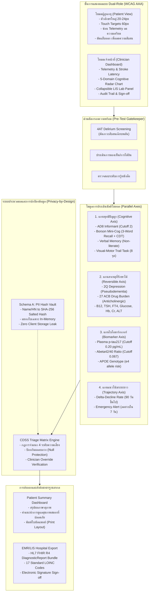

# Thai Cognitive Triage CDSS (Project Alzheimer)
### Multimodal Cognitive Screening & Biomarker-Informed Clinical Decision Support System

---

## 🖥️ Interface Preview

| Patient-Friendly Screening Mode | Clinical Staff & Telemetry Mode |
| :---: | :---: |
|  |  |

---

## 🌐 ระบบการทำงานหลัก (Dual Application Suite)

| แอปพลิเคชัน | URL / การเข้าถึง | หน้าที่หลัก |
| :--- | :--- | :--- |
| **1. Cognitive Screening & CDSS Portal** | [`index.html`](https://natchlimar-droid.github.io/Project-Alzhimer/) | ระบบคัดกรอง 2 มุมมอง (โหมดผู้สูงอายุ Zero-Friction UX + โหมดแพทย์ Clinician Workstation) ประเมิน AD8, Mini-Cog, Clock Drawing Canvas, Visual-Motor Latency, LIS Labs, และส่งออก HL7 FHIR R4 DiagnosticReport |
| **2. NeuroRegistry & ML Triage Dashboard** | [`dashboard.html`](https://natchlimar-droid.github.io/Project-Alzhimer/dashboard.html) | ระบบคลังข้อมูลผู้รับการประเมิน (Pseudonymized Patient Registry 25 เคส), Analytics Dashboard พร้อม Interactive Charts 4 รูปแบบ, และ In-Browser ML Engine (Logistic Regression + L2) ที่เทรนสดบนเบราว์เซอร์พร้อม Fast Triage Calculator |

---

## 📌 บทนำและปัญหาในระบบสาธารณสุขไทย (Problem Statement)
ประเทศไทยได้ก้าวเข้าสู่ **สังคมผู้สูงอายุอย่างสมบูรณ์ (Complete Aged Society)** โดยมีประชากรอายุ 60 ปีขึ้นไปมากกว่า 20% ของประชากรทั้งประเทศ นำมาซึ่งความท้าทายสำคัญในระบบสาธารณสุข:
1. **ภาวะสมองเสื่อมถูกตรวจพบช้า (Delayed Diagnosis):** ผู้ป่วยส่วนใหญ่มาพบแพทย์เมื่อเข้าสู่ระยะสมองเสื่อมชัดเจน (Moderate to Severe Dementia) ซึ่งเลยช่วงเวลาทอง (Golden Period) ในการชะลอโรค
2. **ความแออัดในโรงพยาบาลศูนย์และการขาดแคลนแพทย์เฉพาะทาง:** คลินิกความจำในโรงพยาบาลศูนย์ต้องรับภาระผู้ป่วยจำนวนมากที่ส่งต่อมาโดยไม่มีการคัดกรองหรือแยกแยะสาเหตุที่รักษาหายได้ (Reversible Causes)
3. **ปัญหาความวิตกกังวลจากการทดสอบ (Test Anxiety & Cognitive Overload):** แบบประเมินหรือหน้าจอคอมพิวเตอร์ที่ซับซ้อน เต็มไปด้วยศัพท์เทคนิค สร้างความเครียดให้ผู้สูงอายุจนผลการทดสอบเบี่ยงเบน
4. **การขาดการเชื่อมต่อข้อมูลสู่ระบบโรงพยาบาล (Interoperability Gap):** ผลการคัดกรองเบื้องต้นในชุมชนมักไม่ได้มาตรฐาน ไม่สามารถส่งต่อไปยังระบบเวชระเบียน EMR/HIS ของโรงพยาบาลได้อย่างปลอดภัย

**ระบบ Thai Cognitive Triage CDSS** จึงถูกออกแบบขึ้นเพื่อเป็น **เครื่องมือสนับสนุนการตัดสินใจทางคลินิก (Clinical Decision Support System - CDSS)** ที่เชื่อมโยงระหว่าง **การคัดกรองที่เป็นมิตรต่อผู้สูงอายุในชุมชน/ที่บ้าน (Patient-Facing Mode)** กับ **ระบบวิเคราะห์เชิงลึกและการส่งต่อของผู้ประกอบวิชาชีพเวชกรรม (Clinician Dashboard & EMR Export)**

---

## 📐 สถาปัตยกรรมระบบและกระบวนการทำงาน (System Architecture)

---

## 🧭 ตารางเมทริกซ์การตัดสินใจทางคลินิก (Clinical Triage Decision Matrix)

| สถานะทางคลินิก (Clinical Triage) | เกณฑ์การตัดสินใจของอัลกอริทึม (Decision Rule Criteria) | สัญญาณเตือนและระบบส่งต่อ (Clinical Recommendations) |
| :--- | :--- | :--- |
| 🚨 **CRITICAL_REVERSIBLE** (ภาวะวิกฤต/สาเหตุเร่งด่วน) | 4AT $\ge$ 4 (Delirium), น้ำตาลในเลือด $\le$ 50 mg/dL, หรือคะแนนลดฮวบใน $\le$ 7 วัน | **หยุดทำแบบประเมินทันที** ส่งต่อแผนกฉุกเฉิน (ER) คัดกรองภาวะสับสนเฉียบพลันหรือโรคหลอดเลือดสมอง |
| 🟡 **PSEUDODEMENTIA** (สมองเสื่อมเทียมจากซึมเศร้า) | 2Q ให้ผลบวก (ซึมเศร้า) + มีอาการบ่นเรื่องความจำมาก แต่ Mini-Cog ปกติ หรือคะแนนผันผวน | ส่งต่อจิตแพทย์/แพทย์ปฐมภูมิ เพื่อประเมินภาวะซึมเศร้าก่อนวินิจฉัยอัลไซเมอร์ อาการความจำจะฟื้นคืนได้หลังรักษา |
| 🟠 **HIGH_ACB_BURDEN** (ผลข้างเคียงจากยากดสมอง) | ผลรวมคะแนน ACB Score $\ge$ 3 จากยา 27 รายการ (เช่น CPM, Amitriptyline, Dimenhydrinate) | แนะนำแพทย์/เภสัชกรทำ **Medication Reconciliation (ทบทวนรายการยา)** ลดหรือหยุดยาที่มีฤทธิ์ Anticholinergic |
| 🟢 **REVERSIBLE_METABOLIC** (สาเหตุทางเมแทบอลิกที่รักษาหายได้) | Vitamin B12 $< 200$ pg/mL, TSH $> 10$ mIU/L, FT4 $< 0.8$ ng/dL, Hb $< 8$ g/dL, หรือ eGFR ต่ำ | ให้การรักษาภาวะขาดวิตามิน/ฮอร์โมนไทรอยด์หรือแก้ไตเสื่อม ความจำสามารถฟื้นตัวกลับมาได้ |
| 🟣 **AD_HIGH_RISK_BIOMARKER** (สงสัยอัลไซเมอร์ร่วมกับผลตรวจเลือดบวก) | Mini-Cog ผิดปกติ + Plasma p-tau217 $\ge 0.20$ pg/mL หรือ A$\beta$42/40 $\le 0.067$ | ส่งต่อ **Memory Clinic เฉพาะทาง** เพื่อพิจารณาทำ MRI/Amyloid PET และวางแผนการรักษาด้วยยาต้านอะไมลอยด์ |
| 🔵 **MCI_VS_DEMENTIA** (ภาวะรู้คิดบกพร่องเล็กน้อย vs สมองเสื่อม) | Mini-Cog ผิดปกติ (Recall 0 หรือ Recall 1-2 + CDT ผิดปกติ) **แยกด้วยกิจวัตรประจำวัน (IADL)**:  - IADL ปกติ = **MCI** - IADL บกพร่อง = **Probable Dementia** | - **MCI:** นัดติดตามผลทุก 6 เดือน, ฝึกสมอง, ปรับพฤติกรรม (MIND Diet, Aerobic Exercise) - **Dementia:** วางแผนการดูแลระยะยาว, ตรวจวินิจฉัยเชิงลึก |
| ⚪ **COGNITIVE_NORMAL** (สุขภาพสมองสมวัย) | AD8 $< 2$, Mini-Cog 5/5 หรือ 3-4/5 (Recall ครบ), CDT ปกติ, ไม่มีธงสาเหตุที่รักษาได้ | ตรวจคัดกรองซ้ำปีละ 1 ครั้ง, ส่งเสริมสุขภาพสมองด้วยไลฟ์สไตล์ที่ถูกต้อง |

---

## 🛠️ เทคโนโลยีและมาตรฐานสากล (Tech Stack & Healthcare Standards)

1. **สถาปัตยกรรมระดับซอฟต์แวร์ (Client-Side Architecture):**
   - พัฒนาด้วย Pure Vanilla JavaScript (ES2022), HTML5, CSS3 มาตรฐานใหม่ ไม่พึ่งพาไลบรารีภายนอกหรือ CDN (Zero External Dependency) สามารถทำงานแบบ **Offline-First** ได้ 100%
   - ผ่านการทดสอบ Unit Tests ระดับ Node.js ครบ 100% (Clinical Test Suite Runner)
2. **มาตรฐานเวชสารสนเทศและการแลกเปลี่ยนข้อมูล (Health Informatics Interoperability):**
   - **HL7 FHIR Release 4 (R4):** ส่งออกผลการประเมินในรูปแบบ `Bundle` (Type: `transaction`) บรรจุทรัพยากร `Patient`, `Observation`, และ `DiagnosticReport`
   - **มาตรฐานรหัสตรวจทางคลินิก (LOINC Codes):** รองรับรหัสสากล 17 รายการ เช่น `71485-7` (AD8), `71486-5` (Mini-Cog), `11502-2` (B12), `11580-8` (TSH), `97560-7` (p-tau217)
3. **การปกป้องข้อมูลส่วนบุคคล (Privacy-by-Design & Security):**
   - แยก Schema A (PII: ชื่อ-นามสกุล, HN, เลขบัตรประชาชน) ออกจาก Schema B (Clinical Assessment Vector)
   - ป้องกันการระบุตัวตนด้วย **256-bit Salted SHA-256 Pseudonymization Token**
   - ข้อมูลประมวลผล In-Memory บนเครื่องผู้ใช้ ไม่มีการส่งข้อมูล PII ดิบหรือบันทึกเก็บใน LocalStorage/Cookie
4. **การออกแบบเพื่อผู้สูงอายุ (Elderly-Friendly UX & Accessibility):**
   - ออกแบบตามมาตรฐาน **WCAG 2.1 Level AAA** อัตราส่วนความคมชัด (Contrast Ratio) $\ge 7:1$
   - ปุ่มสัมผัสและตัวเลือกขนาดใหญ่พิเศษ ($\ge 60\times 60$ px) ตัวอักษรเนื้อหาขนาด 20–24px
   - ระบบอ่านออกเสียงภาษาไทย (Thai Text-to-Speech) เพื่ออำนวยความสะดวกแก่ผู้มีปัญหาทางสายตา
   - กลไก **Touch/Stylus Enforcement** และ **Paper-to-Digital Auto-Crop** สำหรับแบบทดสอบวาดนาฬิกา (CDT) เพื่อป้องกันความคลาดเคลื่อนจากการใช้เมาส์คอมพิวเตอร์

---

## 💼 ข้อความสรุปผลงานสำหรับ Portfolio / Resume / LinkedIn

> **Thai Cognitive Triage CDSS (Project Alzheimer):**
> ออกแบบและพัฒนาระบบสนับสนุนการตัดสินใจทางคลินิก (Clinical Decision Support System - CDSS) สำหรับคัดกรองภาวะรู้คิดบกพร่องและอัลไซเมอร์ระยะแรก รองรับมาตรฐานสากล **HL7 FHIR R4** และ **17 LOINC Codes**
> • สถาปัตยกรรม **Parallel Multi-Axis Reporting** แยกประเมิน 4 มิติ (Cognitive, Reversible, Biomarker, Trajectory) พร้อมระบบป้องกันผลลบลวง (Null Input Protection)
> • ระบบ **Dual-Role Interface**: ออกแบบ Patient Mode ตามมาตรฐาน **WCAG AAA** (Touch target $\ge 60$px, ซ่อน Telemetry ลด Test Anxiety) สลับกับ Clinician Dashboard วิเคราะห์ Stroke Latency, Radar Chart และระบบแพทย์ลงนามกำกับ (Clinician Override with License Sign-off)
> • ปกป้องข้อมูลส่วนบุคคลตามมาตรฐาน **HIPAA / PDPA (Privacy-by-Design)** ด้วย Salted SHA-256 Pseudonymization Token แยก PII ออกจาก Clinical Data อย่างเด็ดขาด และทำงานแบบ Zero-Dependency Offline-First

---

## โครงสร้างระบบ (Project Structure)

- [`index.html`](file:///g:/My%20Drive/Project%20Alzhimer/index.html) — เว็บแอปพลิเคชันแบบสมบูรณ์ (Standalone Zero-Build Web Application) พร้อมสถาปัตยกรรม Multi-Axis Reporting, Pre-Test 4AT Gatekeeper, Non-Literate Pathway, Clinician Override, A4 Corporate Print Layout และระบบ Self-Test 18 ชุดในตัว
- [`src/types/clinical.ts`](file:///g:/My%20Drive/Project%20Alzhimer/src/types/clinical.ts) — TypeScript Interfaces และ Type Definitions มาตรฐาน (`ALGORITHM_VERSION = "v2.4.0-clinical-multiaxis"`, 4-Axis Types, `PreTestValidityGate`, `ACBMedicationItem`, `LabResults`, `AssessmentInput`, `RiskOutput`, `ClinicianOverrideRecord`, `LOINC_DATA_MAPPING`)
- [`src/engine/riskStratification.ts`](file:///g:/My%20Drive/Project%20Alzhimer/src/engine/riskStratification.ts) — อัลกอริทึมจำแนกความเสี่ยงทางคลินิก 4 มิติ (`evaluatePreTestValidity`, `stratifyCognitiveRisk`, การป้องกันผลลบลวงจากค่าว่าง, เกณฑ์ระงับการแปลผล p-tau217 ในผู้ป่วยปกติ, การแยกภาวะไทรอยด์แฝง/ชัดเจน, การคำนวณ $\Delta$-Decline Rate $\ge 90$ วัน)
- [`src/engine/cdtAnalyzer.ts`](file:///g:/My%20Drive/Project%20Alzhimer/src/engine/cdtAnalyzer.ts) — โมดูลวิเคราะห์รูปทรงเรขาคณิต เวกเตอร์เข็มนาฬิกา และการกรองความสั่นของกล้ามเนื้อมือ (`analyzeClockDrawingStrokes`, `detectMotorTremorFromStrokes`, `smoothStrokeForTremor`)
- [`src/services/privacyAuditService.ts`](file:///g:/My%20Drive/Project%20Alzhimer/src/services/privacyAuditService.ts) — ระบบรักษาความปลอดภัยข้อมูลตามมาตรฐาน HIPAA / PDPA (การสร้าง Salted Pseudonym Token, In-Memory PII Isolation, Zero Raw PII in LocalStorage, Tamper-Evident Hash Audit Trail)
- [`src/services/fhirService.ts`](file:///g:/My%20Drive/Project%20Alzhimer/src/services/fhirService.ts) — โมดูลส่งออก **HL7 FHIR R4 Collection Bundle** รหัสมาตรฐาน **LOINC** (Observation 104352-0 สำหรับ Plasma p-tau217, Screening Composite Index Extension, Clinician Practitioner Resource)
- [`src/data/clinicalContent.ts`](file:///g:/My%20Drive/Project%20Alzhimer/src/data/clinicalContent.ts) — รายการตรวจคัดกรอง Pre-Test Validity, รายการยา 21 ชนิดพร้อมคะแนน ACB, คลังคำถาม 2Q, คำถาม AD8 ภาษาไทย, ชุดคำศัพท์ Mini-Cog มาตรฐาน TMSE, ตาราง `LOINC_DATA_MAPPING` 17 รายการ และชุดข้อมูลจำลอง
- [`src/engine/riskStratification.test.ts`](file:///g:/My%20Drive/Project%20Alzhimer/src/engine/riskStratification.test.ts) — ชุดทดสอบความถูกต้องของอัลกอริทึมทางคลินิกครบ 13 กรณีทดสอบ (`runClinicalEngineTests`)
- [`src/index.ts`](file:///g:/My%20Drive/Project%20Alzhimer/src/index.ts) — Barrel Export สำหรับการนำไปใช้งานเป็น Library / SDK ภายนอก

---

## สถาปัตยกรรมทางคลินิกและนวัตกรรมระบบ (Clinical Architecture & Enhancements)

### 1. การรายงานผลคู่ขนาน 4 มิติ (Parallel Multi-Axis Reporting Model)
ยกเลิกระบบลำดับชั้นแบบเดิมที่สาเหตุหนึ่งบดบังอีกสาเหตุหนึ่ง (เช่น มีภาวะขาดวิตามินแล้วไม่แสดงผลความเสี่ยงอัลไซเมอร์) เปลี่ยนมาใช้ระบบรายงานผล 4 แกนคู่ขนานตามเวชปฏิบัติจริง:
- **Axis 1 (Cognitive Performance Tier):** ประเมินสมรรถภาพสมอง (`COGNITIVE_NORMAL`, `MCI_SUSPECTED`, `DEMENTIA_SUSPECTED`, `INCOMPLETE_DATA`)
- **Axis 2 (Reversible & Drug-Induced Causes):** ภาวะที่รักษาหรือฟื้นฟูได้ (`HIGH_ACB_BURDEN`, `OVERT_HYPOTHYROIDISM`, `SUBCLINICAL_THYROID_WATCH`, `VITAMIN_B12_DEFICIENCY`, `BORDERLINE_B12_WATCH`, `SEVERE_HYPONATREMIA`, `MILD_HYPONATREMIA_WATCH`, `METABOLIC_NORMAL`, `UNASSESSED`)
- **Axis 3 (Alzheimer's Specific Biomarkers):** ไบโอมาร์กเกอร์เฉพาะโรคอัลไซเมอร์ (`AD_BIOMARKER_POSITIVE`, `AD_BIOMARKER_INTERMEDIATE`, `AD_BIOMARKER_NEGATIVE`, `NOT_INDICATED_ASYMPTOMATIC`, `UNASSESSED`)
- **Axis 4 (Affective / Depressive Modifiers):** ภาวะอารมณ์และซึมเศร้า (`PSEUDODEMENTIA_RISK_2Q_POSITIVE`, `2Q_NEGATIVE`, `UNASSESSED`)

### 2. เกณฑ์การใช้ไบโอมาร์กเกอร์อัลไซเมอร์ตามแนวทางสากล (Alzheimer's Association Biomarker Guidelines)
- ไบโอมาร์กเกอร์ Plasma p-tau217 และ Amyloid $\beta_{42/40}$ มีข้อบ่งชี้ทางคลินิกให้ตรวจเฉพาะในผู้ป่วยที่มีอาการหรือข้อบ่งชี้ทางพุทธิปัญญาเท่านั้น (Cognitively Impaired / Symptomatic Individuals)
- หากผู้ป่วยมีผล Axis 1 เป็นปกติ (`COGNITIVE_NORMAL`) ระบบจะจัดกลุ่ม Axis 3 เป็น **`NOT_INDICATED_ASYMPTOMATIC`** พร้อมขึ้นคำเตือนชัดเจนว่าไม่แนะนำให้คัดกรองในผู้ที่ไม่มีอาการทางคลินิก เพื่อป้องกันภาวะตื่นตระหนกและผลบวกลวง

### 3. ระบบคัดกรองความพร้อมก่อนประเมิน (Pre-Test Validity Gatekeeper - Step 0)
- ตรวจสอบ 4 ข้อห้ามทางคลินิกก่อนเริ่มทำแบบประเมิน:
  1. ภาวะเพ้อเฉียบพลันหรือสับสนฉับพลัน (Acute Confusional State / Delirium)
  2. อุปสรรคทางประสาทสัมผัสขั้นรุนแรง (Severe Uncorrected Visual / Hearing Impairment)
  3. อาการง่วงซึมจากยาระงับประสาทหรือแอลกอฮอล์ (Acute Sedative / Intoxication)
  4. ผู้ป่วยปฏิเสธหรือกระสับกระส่ายรุนแรง (Severe Agitation / Patient Distress)
- หากพบข้อห้ามใดข้อห้ามหนึ่ง ระบบจะแจ้งเตือนและระงับการทำแบบทดสอบทันทีเพื่อป้องกันผลการประเมินที่คลาดเคลื่อน

### 4. ระบบบันทึกและปรับเปลี่ยนการตัดสินใจโดยแพทย์ (Clinician Override & Medical License Sign-Off)
- แพทย์ผู้ตรวจสามารถลงบันทึกเลขที่ใบอนุญาตประกอบวิชาชีพเวชกรรม (Medical License ID)
- แพทย์สามารถปรับเปลี่ยนระดับความเสี่ยง (Clinical Tier Override) พร้อมระบุเหตุผลทางคลินิก (เช่น "ผู้ป่วยมีโรคประจำตัวเรื้อรังกำเริบชั่วคราว", "ระดับการศึกษาต่ำกว่าเกณฑ์มาตรฐาน") โดยระบบจะบันทึกลงใน Audit Trail และ FHIR Bundle

### 5. การป้องกันผลลบลวงจากข้อมูลไม่ครบถ้วน (Null Input & False-Negative Prevention)
- ค่าเริ่มต้นของข้อมูลการประเมินหลัก (AD8, Free Recall, CDT) เป็น `null` ทั้งหมด
- หากผู้ป่วยทำแบบทดสอบไม่ครบทุกมิติ ระบบจะระบุสถานะ `isComplete: false` แสดงกล่องเตือน **"ข้อมูลการประเมินไม่ครบถ้วน (Incomplete Assessment)"** พร้อมระบุรายชื่อโมดูลที่ขาดหาย และปิดกั้นการคำนวณคะแนนรวมและข้อแนะนำหลัก เพื่อป้องกันการแปลผลผิดพลาดว่าเป็นปกติ (False Negative)

### 6. การให้ความสำคัญกับ Free Recall ใน Mini-Cog
- การคิดคะแนน Mini-Cog (0–5 คะแนน) ตัดสินจาก **Spontaneous Free Recall (0–3 คะแนน)** ร่วมกับ **Clock Drawing Test (0 หรือ 2 คะแนน)** เท่านั้น
- การทดสอบเลือกคำศัพท์จากตัวเลือก (Cued Recognition: 3 จาก 9 คำ) จะถูกบันทึกเป็นข้อมูลเชิงคุณภาพประกอบ (`cuedRecognitionScore`) เพื่อช่วยแยกแยะระหว่าง Retrieval Deficit กับ Encoding/Storage Deficit แต่ **ไม่นำมาคิดเพิ่มในคะแนนทางการ**

### 7. การระบุสถานะงานวิจัยใน Visual-Motor Task (Trail Making 8 จุด)
- ติดป้ายกำกับชัดเจนว่าเป็น **"ตัวชี้วัดเชิงทดลองในงานวิจัย (Experimental Research Telemetry)"**
- ข้อมูลระยะเวลาและข้อผิดพลาดใน Trail Making จะไม่ถูกนำไปเปลี่ยนแปลงระดับความเสี่ยงหลักของพุทธิปัญญา จนกว่าจะมีข้อมูลค่ามาตรฐาน (Normative Data) ในประชากรไทยที่ผ่านการรับรอง

### 8. ดัชนีคะแนนรวมภายใน (Internal Screening Composite Index: 0–100 จุด)
- ตัวเลขคะแนนสรุป 0–100 จุด คือ **"ดัชนีคะแนนรวมภายในเพื่อการจัดลำดับความเร่งด่วน (Internal Screening Composite Index)"** ไม่ใช่ค่าความน่าจะเป็นทางสถิติ (Statistical Probability)
- ในมาตรฐาน HL7 FHIR R4 คะแนนนี้จะถูกส่งออกเป็น FHIR Extension (`screening-composite-index`) และไม่ส่งออกในฟิลด์ `probabilityDecimal`

### 9. การจำแนกความผิดปกติทางชีวเคมีที่แก้ไขได้ (Reversible Metabolic Conditions)
- **ต่อมไทรอยด์**: แยกแยะระหว่าง Overt Hypothyroidism (TSH $> 10\,\mu\text{IU/mL}$ หรือ TSH $> 4.2$ ร่วมกับ Free T4 $< 0.93\,\text{ng/dL}$) ออกจาก Subclinical Thyroid Watch (TSH ระหว่าง $4.2 - 10.0\,\mu\text{IU/mL}$ แต่ Free T4 ปกติ)
- **วิตามินบี 12**: แยกแยะภาวะขาดชัดเจน ($< 200\,\text{pg/mL}$) ออกจากภาวะก้ำกึ่ง (Borderline $200 - 300\,\text{pg/mL}$)
- **เกลือแร่โซเดียม**: แยกแยะ Severe Hyponatremia ($< 130\,\text{mEq/L}$) ออกจาก Mild Hyponatremia ($130 - 134\,\text{mEq/L}$)

### 10. การติดตามความเสื่อมถอยระยะยาว ($\Delta$-Decline Rate $\ge 90$ วัน)
- การคำนวณอัตราความเสื่อมถอยต่อปี ($\Delta$-Decline Rate per Year) จะทำได้ก็ต่อเมื่อระยะเวลาระหว่างครั้งก่อนและครั้งปัจจุบันห่างกันอย่างน้อย **90 วัน** เพื่อให้การประมาณการมีความน่าเชื่อถือทางคลินิก

### 11. ภาระยาต้านโคลิเนอร์จิก (ACB Scale) ครบ 27 รายการยาที่พบบ่อยในไทย
- บรรจุรายการยา 27 ชนิดพร้อมคะแนนตามหลักฐานทางเภสัชวิทยา (เกณฑ์รวม $\ge 3$ บ่งชี้ความเสี่ยงสมองตื้อจากยา):
  - **ACB Score = 3**: Amitriptyline, Nortriptyline, Chlorpheniramine (CPM), Hydroxyzine, Diphenhydramine, Dimenhydrinate, Trihexyphenidyl, Oxybutynin, Tolterodine, Imipramine, Doxepin, Clomipramine, Cyproheptadine
  - **ACB Score = 2**: Carbamazepine, Baclofen, Cetirizine, Meclizine, Loperamide, Belladonna Alkaloids
  - **ACB Score = 1**: Diazepam, Lorazepam, Alprazolam, Atenolol, Ranitidine, Furosemide, Haloperidol, Risperidone

### 12. การปกป้องข้อมูลส่วนบุคคลและการพิมพ์มาตรฐานองค์กร (HIPAA / PDPA & Corporate Print Layout)
- แยก PII (ชื่อ-นามสกุล, เลขบัตรประชาชน) ให้อยู่เฉพาะใน Memory เท่านั้น
- แปลงรหัสแฝงด้วย Pure JavaScript 256-bit SHA-256 (`PSN-...`) โดยไม่มีการเก็บข้อมูลระบุตัวตนจริงลงใน `localStorage`
- การใช้เสียงวิเคราะห์ Speech Biomarkers มีขั้นตอนขอความยินยอม (Consent Modal) แจ้งชัดเจนเรื่องการประมวลผลเสียงและสถานะงานวิจัย
- **Corporate A4 Print Layout (`@media print`):** จัดพิมพ์รายงานความเสี่ยงขนาด A4 แนวตั้ง (Margin 1.5 cm) ตาราง 1px พร้อมบล็อกลงนามแพทย์และเจ้าหน้าที่ 3 คอลัมน์ ป้องกันการตัดขาดข้ามหน้า (`page-break-inside: avoid`)

---

## ตารางรหัสมาตรฐานสากล LOINC ในระบบ (LOINC Code Mapping)

| รายการตรวจ (Biomarker / Assessment) | ฟิลด์ข้อมูล (Field Key) | รหัส LOINC | หน่วยมาตรฐาน |
| :--- | :--- | :--- | :--- |
| 2Q Depression Screening Panel | `depression_risk_flag` | `55758-7` (`44255-8`, `44250-9`) | Boolean |
| Anticholinergic Cognitive Burden (ACB) | `acbTotalScore` | `LP268153-6` | `{score}` |
| Acoustic Speech MCI Biomarkers | `speech_mci_biomarker_flag` | `LP419518-8` | Boolean |
| AD8 Informant Total Score | `ad8Score` | `71485-7` | `{score}` |
| Mini-Cog Word Recall / CDT | `delayedRecallScore` / `cdtResult` | `72170-4` / `72171-2` | `{score}` |
| Trail Making Task Completion Time | `visualMotorTimeMs` | `72106-8` | `ms` |
| 4AT Rapid Clinical Delirium Assessment | `fourAtTotalScore` | `95420-6` | `{score}` |
| Brief 4-Item IADL Disability | `iadlImpairedCount` | `72105-0` | `{score}` |
| Category Verbal Fluency (Animal Naming) | `animalNamingCount` | `72166-2` | `{count}` |
| TSH (Thyrotropin) | `tsh_uIU_mL` | `3016-3` | `uIU/mL` |
| Free T4 | `free_t4_ng_dL` | `3024-7` | `ng/dL` |
| Vitamin B12 (Cobalamin) | `vitamin_b12_pg_mL` | `2132-9` | `pg/mL` |
| Serum Sodium (Na+) | `sodium_mEq_L` | `2951-2` | `mEq/L` |
| Serum Calcium | `calcium_mg_dL` | `17861-6` | `mg/dL` |
| Fasting Blood Glucose | `fasting_glucose_mg_dL` | `1558-6` | `mg/dL` |
| Serum Creatinine | `creatinine_mg_dL` | `2160-0` | `mg/dL` |
| Hemoglobin | `hemoglobin_g_dL` | `718-7` | `g/dL` |
| ALT (Alanine Aminotransferase) | `alt_U_L` | `1742-6` | `U/L` |
| AST (Aspartate Aminotransferase) | `ast_U_L` | `1920-8` | `U/L` |
| Serum Folate | `folate_ng_mL` | `2284-8` | `ng/mL` |
| HbA1c | `hba1c_percent` | `4548-4` | `%` |
| LDL / HDL Cholesterol | `ldl_mg_dL` / `hdl_mg_dL` | `2089-1` / `2085-9` | `mg/dL` |
| eGFR (CKD-EPI) | `egfr_mL_min` | `62238-1` | `mL/min/1.73m2` |
| APOE Genotype | `apoe_genotype` | `41762-6` | Genotype |
| **Plasma p-tau217 (Official LOINC)** | `plasma_ptau217_pg_mL` | **`104352-0`** | `pg/mL` |
| Amyloid Beta 42/40 Ratio | `abeta_42_40_ratio` | `94660-8` | `{ratio}` |

---

## ชุดทดสอบความถูกต้องทางคลินิก (Clinical Verification Test Suite - 18 Tests)

ระบบมีชุดทดสอบครอบคลุมหลักเกณฑ์ทางคลินิกครบ 18 ประเด็น สามารถรันได้ทั้งในระบบทดสอบและผ่านปุ่ม "🧪 ผลทดสอบระบบ (Unit Tests)" บนหน้าเว็บ:
1. **Test 1: Incomplete Assessment Protection** — ข้อมูลไม่ครบถ้วนต้องแสดง `isComplete: false` และไม่คำนวณคะแนนหลอก
2. **Test 2: Pre-Test Delirium Gatekeeper** — ภาวะ Delirium ต้องหยุดการประเมินทันที
3. **Test 3: Parallel Multi-Axis Reporting (No Masking)** — ภาวะขาดวิตามินบี 12 ต้องไม่บดบังภาวะเสื่อมถอยรุนแรงใน Axis 1
4. **Test 4: Asymptomatic Biomarker Screening Restriction** — ห้ามแปลผล p-tau217 ในผู้ป่วยปกติ (`NOT_INDICATED_ASYMPTOMATIC`)
5. **Test 5: Subclinical vs Overt Hypothyroidism** — แยกแยะระดับความรุนแรงของโรคต่อมไทรอยด์
6. **Test 6: Free Recall Priority in Mini-Cog** — Free Recall 1/3 + CDT ปกติ ได้คะแนน 3/5 และบันทึก Retrieval Deficit
7. **Test 7: Specific ACB Medication Scoring** — คำนวณคะแนนตามรายการยาจริง (เช่น CPM 3 + Amitriptyline 3 = 6)
8. **Test 8: Visual-Motor Telemetry Labeled as Experimental** — ไม่นำเวลา Trail 8 จุดไปเปลี่ยนผลความเสี่ยงหลัก
9. **Test 9: Affective / 2Q Depressive Axis** — ตรวจจับความเสี่ยงสมองเสื่อมเทียม (Pseudodementia) ใน Axis 4
10. **Test 10: Longitudinal Tracking & Acute Precipitous Decline** — ตรวจจับการถดถอยเฉียบพลันภายใน < 90 วัน
11. **Test 11: Clinician Decision Override** — บันทึกการตัดสินใจของแพทย์และเลขที่ใบอนุญาตเวชกรรม
12. **Test 12: Motor Tremor Filtering in Clock Drawing** — แยกแยะความสั่นของกล้ามเนื้อ (Tremor) จากความบกพร่องเชิงพื้นที่
13. **Test 13: Isolated Aβ42/40 Ratio Evaluation** — แปลผลอัตราส่วน Aβ42/40 โดยไม่รายงานผลบวกลวงว่า p-tau217 เป็นลบ
14. **Test 14: Comprehensive Lab Biomarkers** — ตรวจจับภาวะน้ำตาลต่ำ (Hypoglycemia), โลหิตจาง (Anemia), ไตวายรุนแรง (Cr 3.5), ขาดโฟเลต และ Central Hypothyroidism
15. **Test 15: Brief Thai 4-Item IADL & 4AT Bedside Delirium Assessment** — บันทึกคะแนน 4AT และ IADL อย่างถูกต้อง
16. **Test 16: Chained End-to-End 4AT Delirium Gatekeeper Integration** — 4AT $\ge 4$ ระงับการทดสอบทันที
17. **Test 17: IADL vs AD8 Discrepancy Detection** — จำแนกระดับ MCI เมื่อญาติสังเกตอาการแต่กิจวัตร IADL ยังทำได้เอง
18. **Test 18: Non-Literate Alternative Pathway** — ใช้ Animal Naming (< 10 ตัว/นาที) สำหรับผู้สูงอายุที่ไม่รู้หนังสือโดยไม่บังคับวาดนาฬิกา

---

## ข้อจำกัดความรับผิดชอบ (Regulatory & SaMD Disclaimer)
> "ระบบนี้เป็นเพียงเครื่องมือช่วยคัดกรองความเสี่ยงเบื้องต้น (Clinical Decision Support Tool) ไม่ใช่การวินิจฉัยโรคทางการแพทย์ และผลการประเมินต้องได้รับการยืนยันโดยแพทย์ระบบประสาทหรือแพทย์ผู้เชี่ยวชาญเท่านั้น"