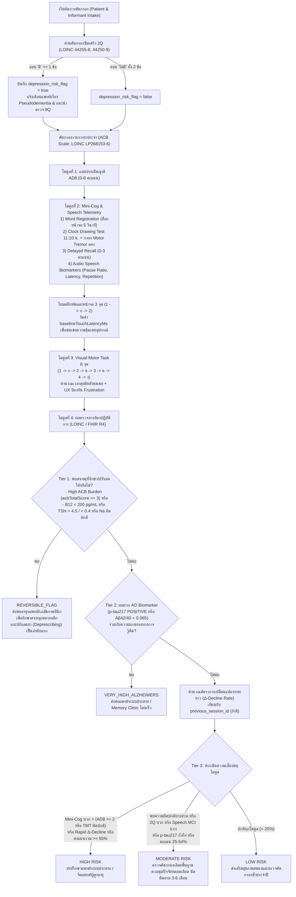

# Clinical Decision Support (CDS) & System Architecture Specification

เอกสารฉบับนี้อธิบายสถาปัตยกรรมการประมวลผลทางคลินิก (Clinical Informatics Architecture) ของระบบคัดกรองความเสี่ยงภาวะสมองรู้คิดบกพร่องและอัลไซเมอร์เบื้องต้น (**Multimodal Cognitive Screening & Biomarker-Informed Triage System**)

---

## 1. แผนผังลำดับชั้นการตัดสินใจทางคลินิก (Hierarchical Stratification Flowchart)

---

## 2. สมการการปรับเทียบความคุ้นเคยหน้าจอสัมผัส (Device Touch Calibration Formula)

ผู้สูงอายุอาจไม่คุ้นเคยกับการใช้นิ้วแตะหน้าจอสัมผัส (Touchscreen Motor Unfamiliarity) ทำให้ใช้เวลาใน Visual-Motor Task นานขึ้นโดยไม่ได้เกิดจากภาวะ Executive Dysfunction ระบบจึงกำหนดให้ทำ **Practice Mode 3 จุด (`1 -> ก -> 2`)** ก่อนเริ่มจับเวลาจริง:

1. วัดค่าความหน่วงเฉลี่ยต่อการแตะในโหมดฝึกหัด:
   $$\text{baselineTouchLatencyMs} = \frac{t_{\text{ก} \leftarrow 1} + t_{2 \leftarrow \text{ก}}}{2}$$
2. หาก $\text{baselineTouchLatencyMs} > 1,500\text{ ms}$ ระบบจะคำนวณค่าชดเชยเวลาสำหรับ 7 ช่วงการเคลื่อนที่ในแบบทดสอบจริง (เพดานสูงสุดไม่เกิน $18,000\text{ ms}$):
   $$\text{calibrationAllowanceMs} = \min\Big(18000,\ \text{round}\big((\text{baselineTouchLatencyMs} - 1500) \times 7 \times 0.65\big)\Big)$$
3. เวลาสุทธิที่ใช้ตัดสินความเสี่ยง (Calibrated Net Completion Time):
   $$\text{calibratedNetTimeMs} = \max\big(1000,\ \text{visualMotorTimeMs} - \text{calibrationAllowanceMs}\big)$$
4. เกณฑ์เวลามาตรฐานปรับตามอายุและระดับการศึกษา (`adjustedThresholdMs`):
   $$\text{adjustedThresholdMs} = 45000 + \begin{cases} 12000 & \text{ถ้า } \text{yearsOfEducation} < 6 \\ 0 & \text{กรณีอื่น} \end{cases} + \begin{cases} 10000 & \text{ถ้า } \text{age} \ge 75 \\ 0 & \text{กรณีอื่น} \end{cases}$$

---

## 3. สมการคำนวณอัตราความเปลี่ยนแปลงระยะยาว ($\Delta$-Decline Rate)

เมื่อมีการระบุ `previous_session_id` พร้อมข้อมูลเซสชันก่อนหน้า ระบบจะคำนวณ:

$$\Delta\text{RiskScore} = \text{RiskScore}_{\text{current}} - \text{RiskScore}_{\text{previous}}$$

$$\text{Annualized }\Delta\text{-Decline Rate (\%/year)} = \left(\frac{\Delta\text{RiskScore}}{\max(1, \text{daysElapsed})}\right) \times 365$$

- **`RAPID_DECLINE`**: เมื่อ $\text{Annualized }\Delta\text{-Decline Rate} \ge +25\%/\text{ปี}$ หรือ $\Delta\text{RiskScore} \ge +20\%$ หรือ $\Delta\text{DelayedRecall} \le -2\text{ คำ}$ หรือ $\Delta\text{AD8} \ge +3\text{ คะแนน}$
- **`PROGRESSIVE_DECLINE`**: เมื่อ $\Delta\text{RiskScore} \ge +8\%$ หรือ $\Delta\text{DelayedRecall} \le -1\text{ คำ}$ หรือ $\Delta\text{AD8} \ge +1\text{ คะแนน}$ หรือ $\Delta\text{VisualMotorTime} \ge +10,000\text{ ms}$
- **`STABLE`**: การเปลี่ยนแปลงอยู่ในช่วงความแปรปรวนปกติ
- **`IMPROVED`**: เมื่อ $\Delta\text{RiskScore} \le -8\%$ หรือจำคำศัพท์ได้ดีขึ้น

---

## 4. ไฟล์ตัวอย่าง HL7 FHIR R4 Bundle สำหรับทดสอบนำเข้า (Sample Bundles)

สามารถใช้ไฟล์ในโฟลเดอร์ [`samples/`](../samples/) เพื่อทดสอบปุ่ม **"📂 นำเข้าไฟล์ FHIR R4 Bundle (.json)"** ในโมดูลที่ 4 ได้ทันที:
- [`samples/fhir-reversible-b12-hypothyroid.json`](../samples/fhir-reversible-b12-hypothyroid.json) — ตัวอย่างผลแล็บ FHIR R4 ของผู้ป่วยที่มีภาวะพร่องวิตามิน B12 (`135 pg/mL`, LOINC `2132-9`) และภาวะพร่องฮอร์โมนไทรอยด์ (`TSH = 8.6 uIU/mL`, LOINC `3016-3`; `Free T4 = 0.68 ng/dL`, LOINC `3024-7`)
- [`samples/fhir-alzheimers-ptau217-positive.json`](../samples/fhir-alzheimers-ptau217-positive.json) — ตัวอย่างผลแล็บ FHIR R4 ของผู้ป่วยที่มีผลบวกจำเพาะต่อโรคอัลไซเมอร์ (`Plasma p-tau217 = 0.74 pg/mL`, LOINC `LP438664-7`; `Aβ42/40 Ratio = 0.048`, LOINC `94660-8`; `APOE = e4/e4`, LOINC `41762-6`)
- [`samples/fhir-acb-speech-tremor.json`](../samples/fhir-acb-speech-tremor.json) — ตัวอย่างผลประเมิน FHIR R4 ของผู้ป่วยที่มีภาระยาต้านโคลิเนอร์จิกสูง (`ACB Total Score = 6`, LOINC `LP268153-6`), เมทริกซ์เสียงเสี่ยงต่อ MCI (`speech_mci_biomarker_flag = true`, LOINC `LP419518-8`), และการตรวจพบมือสั่นแบบแยกแยะมิติ (`motor_tremor_flag = true` ร่วมกับ CDT ปกติ) พร้อมระบุรหัสนิรนามตามมาตรฐาน HIPAA/PDPA (`PSN-E821-4F2A90C1-B739`)

---

## 5. การจัดการภาระยาต้านโคลิเนอร์จิก (Anticholinergic Cognitive Burden: ACB Scale)

ยาที่ผู้สูงอายุรับประทานเป็นประจำหลายกลุ่มมีฤทธิ์ยับยั้งสารสื่อประสาท Acetylcholine ซึ่งจำเป็นต่อการสร้างความจำในสมองส่วนฮิปโปแคมปัส ส่งผลให้เกิด **Drug-Induced Cognitive Impairment (ภาวะสมองตื้อชั่วคราวจากยา)**

ระบบประเมินตาม **ACB Scale**:
- **คะแนน 3 (Definite / High Anticholinergic Activity):** ยาแก้แพ้รุ่นที่ 1 (CPM, Hydroxyzine), ยาต้านซึมเศร้าไตรไซคลิก (Amitriptyline, Nortriptyline), ยาลดการบีบเกร็งกระเพาะปัสสาวะ (Oxybutynin, Tolterodine)
- **คะแนน 2 (Moderate Activity):** Hyoscine-N-butylbromide (Buscopan), Dicyclomine, Orphenadrine
- **คะแนน 1 (Potential / Mild Activity / CNS Depressant):** ยานอนหลับ Benzodiazepines (Lorazepam, Diazepam), Z-drugs

**เกณฑ์การตัดสินใจทางคลินิก (Clinical Rule):**
$$\text{acbTotalScore} = \sum_{m \in \text{Selected}} \text{acbScore}(m)$$
$$\text{high\_acb\_risk\_flag} = \text{true } \iff \text{acbTotalScore} \ge 3$$

เมื่อ `high_acb_risk_flag = true` ระบบจะกำหนดผลเป็น `REVERSIBLE_FLAG` พร้อมข้อเสนอแนะให้แพทย์และเภสัชกรคลินิกดำเนินการ **Deprescribing (การทบทวนและปรับลดยา)** ก่อนที่จะวินิจฉัยโรคสมองเสื่อมถาวร

---

## 6. เมทริกซ์เสียงพูดบ่งชี้ความเสี่ยงระยะก่อนสมองเสื่อม (Speech Biomarkers in MCI)

ระบบรองรับการสกัดคุณลักษณะทางสรีรวิทยาของเสียงพูด (Acoustic & Linguistic Telemetry) ขณะทำแบบทดสอบ Delayed Recall หรือ Category Verbal Fluency:

| เมทริกซ์ (Metric) | คำจำกัดความทางเทคนิค | ค่าเกณฑ์ความผิดปกติ (Cutoff) | นัยสำคัญทางการแพทย์ (Clinical Interpretation) |
| :--- | :--- | :--- | :--- |
| **Pause-to-Speech Ratio** | $\frac{\text{Duration}_{\text{silence}}}{\text{Duration}_{\text{voiced}} + \text{Duration}_{\text{silence}}}$ | $> 0.45$ | ภาวะนึกคำศัพท์ลำบาก (Word-Finding Difficulty / Anomia) พบเด่นชัดในระยะต้นของ MCI |
| **Phonetic Latency** | เวลาหน่วงจากสิ้นสุดคำสั่งจนถึง onset ของพยางค์แรก | $> 2,200\text{ ms}$ | ความเร็วในการประมวลผลและการเข้าถึงคลังคำศัพท์ช้าลง (Slowed Linguistic Processing Speed) |
| **Semantic Repetition** | จำนวนคำศัพท์ที่ผู้ป่วยพูดซ้ำในหมวดหมู่เดียวกัน | $\ge 2\text{ ครั้ง}$ | การบกพร่องของ Working Memory และกระบวนการตรวจทานการตอบสนองตนเอง (Response Monitoring Deficit) |

---

## 7. การแยกแยะ Motor Tremor vs Cognitive Deficit และ Non-Punitive UX

### 7.1 Kinematic Tremor Decomposition ใน Clock Drawing Test (CDT)
ผู้ป่วยสูงอายุจำนวนมากมีภาวะมือสั่นจากความชรา (Senile Tremor) หรือโรคพาร์กินสัน (Parkinsonism) แต่ความจำและมิติสัมพันธ์ยังปกติ หากใช้อัลกอริทึมทั่วไปตรวจจับเฉพาะความเรียบของเส้น ผู้ป่วยกลุ่มนี้จะถูกหักคะแนนเป็น `ABNORMAL` แบบผลบวกลวง

ระบบจึงใช้สมการแยกแยะความสั่น:
1. คำนวณเส้น Smoothed Moving Average ($W = 5$ จุด):
   $$\bar{x}_i = \frac{1}{2k+1}\sum_{j=-k}^k x_{i+j},\quad \bar{y}_i = \frac{1}{2k+1}\sum_{j=-k}^k y_{i+j}$$
2. วัดขนาดความสั่นสะเทือนแบบ Root Mean Square (RMS Jitter):
   $$\text{RMS}_{\text{jitter}} = \sqrt{\frac{1}{N}\sum_{i=1}^N \big((x_i - \bar{x}_i)^2 + (y_i - \bar{y}_i)^2\big)}$$
3. วัดอัตราการเปลี่ยนทิศทางแบบสลับกลับไปมา (Direction Reversal Rate):
   $$\text{reversalRate} = \frac{\sum_{i=2}^{N-1} \mathbb{I}\left((\vec{v}_i \cdot \vec{v}_{i-1}) < 0\right)}{N-2}$$
4. เกณฑ์การตรวจจับ Motor Tremor:
   $$\text{motorTremorDetected} = \text{true } \iff \big(\text{RMS}_{\text{jitter}} \ge 1.75\text{ px}\big) \land \big(\text{reversalRate} \ge 0.22\big)$$
5. **การตัดสินผล:** ระบบนำเส้น Smoothed ไปวิเคราะห์โครงร่างวงกลมและการชี้เข็ม 11:10 น. หากตำแหน่งถูกต้อง ผลการประเมินจะคงเป็น `NORMAL` โดยบันทึก `motor_tremor_flag = true` เพื่อให้แพทย์ทราบอาการมือสั่นแยกต่างหากจากการรู้คิด

### 7.2 การป้องกัน Frustration Trigger ใน Visual-Motor Task
ผู้สูงอายุเมื่อกดผิดซ้ำแล้วมีสัญญาณไฟกะพริบสีแดงหรือเสียงปี๊บดังเตือน ความเครียดเฉียบพลันจะทำให้คอร์ติซอลหลั่งและคะแนนความจำรอบถัดไปลดลง ระบบจึงใช้:
- แอนิเมชันสั่นเตือนนุ่มนวล (`.gentle-nudge`) แทนการกะพริบสีแดงจัด
- จุดเป้าหมายถัดไปจะเรืองแสงสีเขียวอ่อนนวล (`.target-hint-glow`) เป็นเวลา 1.4 วินาทีเพื่อช่วยนำสายตา
- กล่องข้อความแนะแนวที่ใช้ภาษาอบอุ่นและไม่กดดัน

---

## 8. สถาปัตยกรรมความมั่นคงปลอดภัยตามมาตรฐาน HIPAA / PDPA

### 8.1 สถาปัตยกรรมแยกสองสคีมา (Two-Schema Pseudonymization)

```mermaid
flowchart LR
    subgraph PII_Vault["Schema A: Identifiable PII Vault (จัดเก็บแยกเฉพาะ เข้ารหัสเข้มงวด)"]
        A1["ชื่อ-นามสกุลจริง"]
        A2["เลขประจำตัวประชาชน (Masked)"]
        A3["เบอร์โทรศัพท์ (Masked)"]
    end

    Token["Deterministic Pseudonym Token\n(เช่น PSN-E821-4F2A90C1-B739)\nคำนวณด้วย Salt + Hex Hash"]

    subgraph Clinical_Vector["Schema B: De-identified Clinical Screening Vector (IP-Safe / CDSS)"]
        B1["คะแนน AD8 / Mini-Cog / TMT"]
        B2["CDT Kinematics & Speech Biomarkers"]
        B3["ผลแล็บ Biomarkers (LOINC)"]
        B4["ระดับความเสี่ยง Risk Category"]
    end

    PII_Vault <-->|"เชื่อมโยงเฉพาะ Token"| Token
    Token <-->|"อ้างอิงเฉพาะ Token"| Clinical_Vector
```

### 8.2 ห่วงโซ่บันทึกการเข้าถึงข้อมูลที่ไม่สามารถแก้ไขย้อนหลังได้ (Immutable Audit Trail)
ทุกครั้งที่มีการประเมินความเสี่ยง, นำเข้าผลแล็บจาก HIS/LIS, นำเข้า FHIR Bundle หรือส่งออกรายงาน ระบบจะสร้างบันทึก Audit Log ที่มี Hash Chain เชื่อมโยงกัน:

$$\text{CanonicalString}_k = \text{previousHash}_{k-1} \,\|\, \text{timestampIso}_k \,\|\, \text{actorRole}_k \,\|\, \text{actionType}_k \,\|\, \text{sessionId}_k \,\|\, \text{pseudonymToken}_k \,\|\, \text{resourceSummary}_k$$

$$\text{integrityHash}_k = \text{HexHash}\left(\text{CanonicalString}_k\right)$$

หากมีการแก้ไข ลบ หรือสลับลำดับบันทึกใดๆ ห่วงโซ่ `previousHash` $\rightarrow$ `integrityHash` จะขาดออกจากกันทันที ทำให้สามารถตรวจสอบความโปร่งใสและหลักฐานทางเวชระเบียน (Tamper-Evident EMR Auditability) ได้อย่างสมบูรณ์

